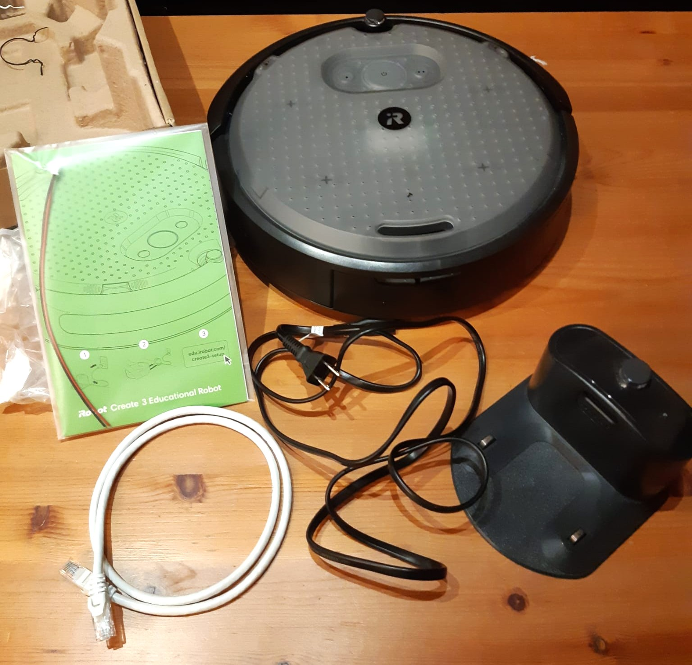
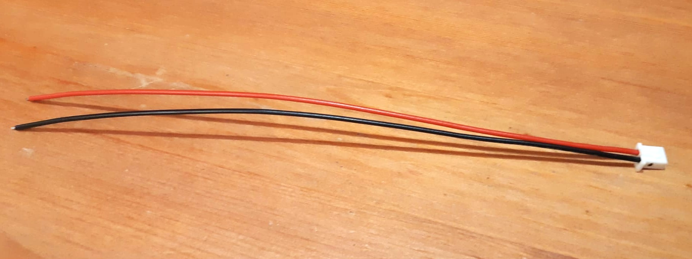
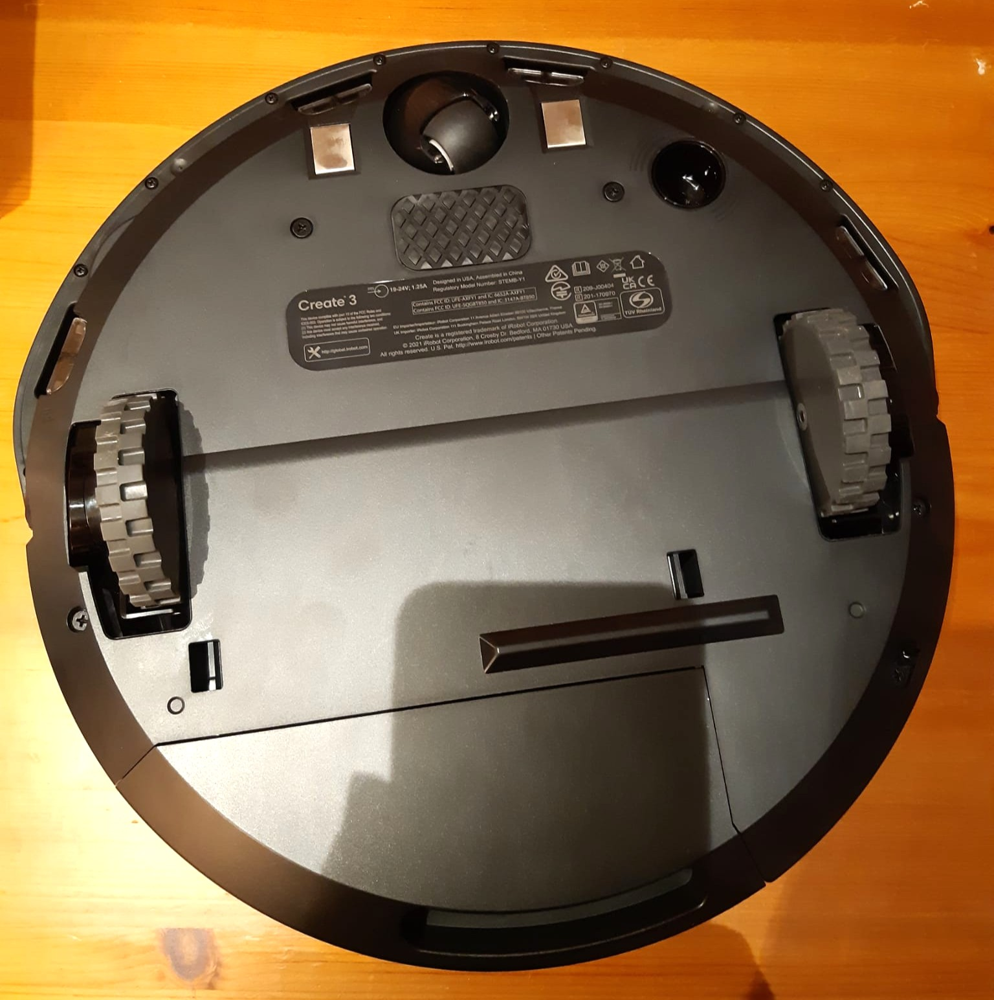
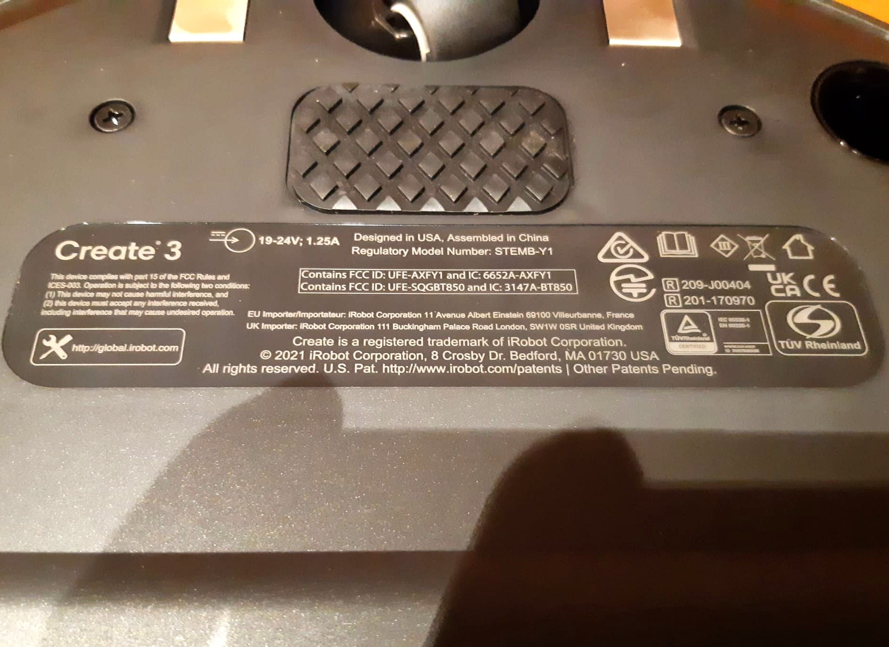
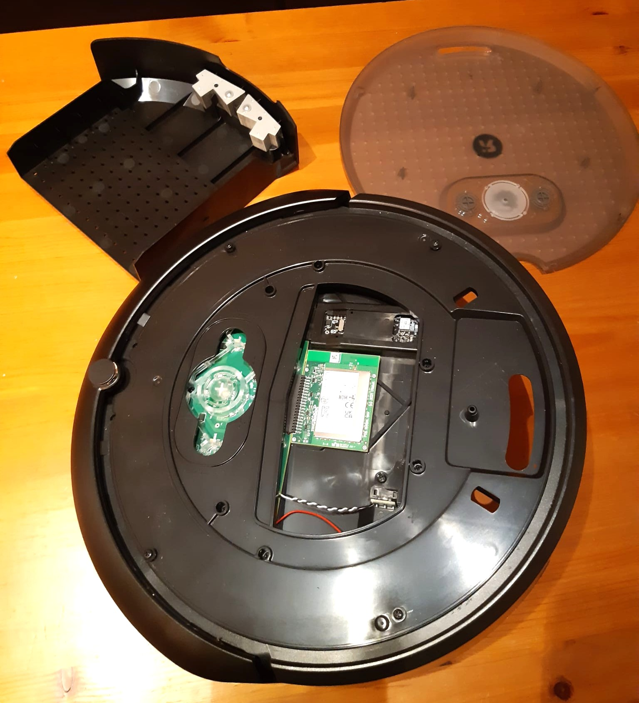
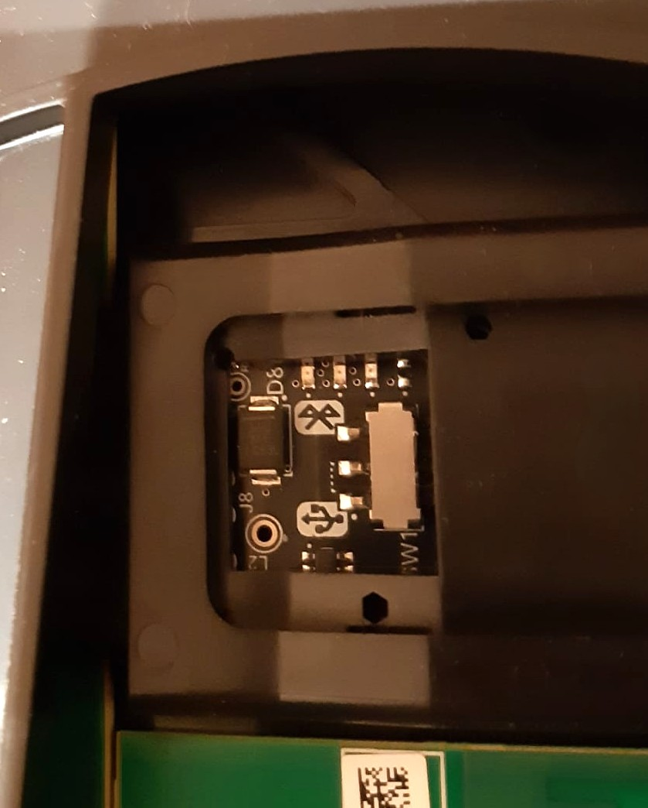
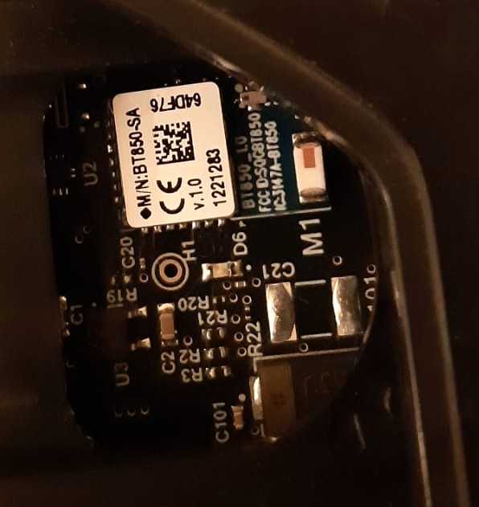
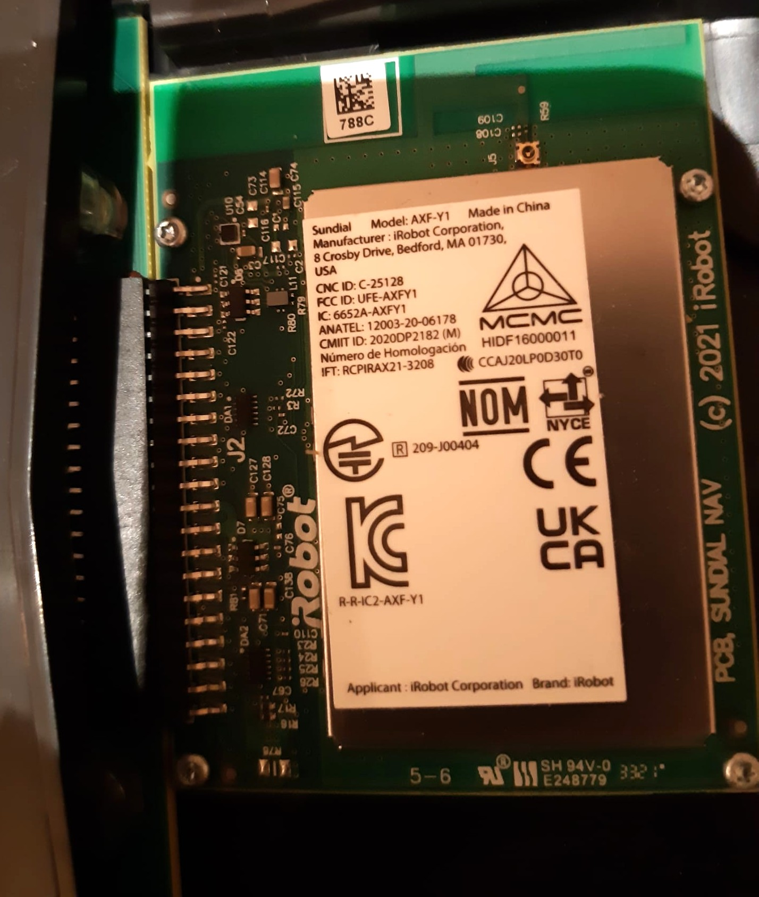
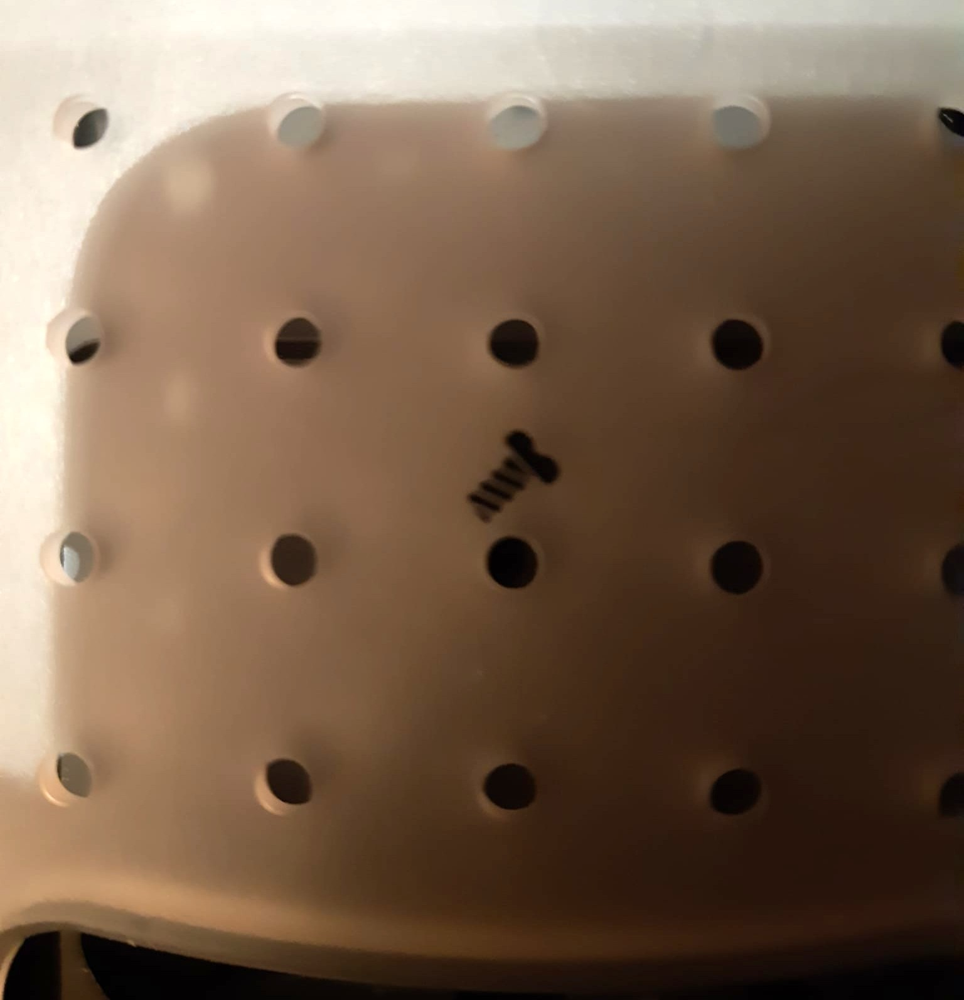

# iRobot Create 3 Hardware Inventory

## Robot

- Model: iRobot Create 3 Educational Robot

- Condition: Good used condition

- Serial number:

- Previous owner:

- Date received: October 31, 2026

## Included Items

- [x] iRobot Create 3 robot

- [x] Home Base charging dock

- [x] Charging dock power cable

- [x] Ethernet cable

- [x] Original box

- [x] Original molded packaging

- [x] Printed Create 3 documentation / quick-start guide

- [x] Raw battery power cable / JST power pigtail

- [ ] Other accessories

### Package Contents

## Additional Accessories

### Raw Battery Power Cable

- 2-pin JST XH-style connector

- Red wire: battery positive

- Black wire: battery negative

- Intended for powering external payload electronics

- Create 3 battery voltage: approximately 12-16.8 V

- Maximum documented current: 2 A

- Status: received, not connected

## Top of Robot

- [x] Removable faceplate

- [x] Light ring

- [x] Button 1

- [x] Center button

- [x] Button 2

- [x] Docking sensor

- [x] IR obstacle sensors

- [x] Multi-zone bumper

- [x] Cable passthrough

## Bottom of Robot

- [x] Left drive wheel

- [x] Right drive wheel

- [x] Front caster wheel

- [x] Four cliff sensors

- [x] Optical odometer

- [x] Charging contacts

- [x] Cargo bay / removable compartment

- [x] Carry handle

- [x] Regulatory identification label

### Bottom View

### Identification

- Product: iRobot Create 3

- Regulatory model: STEMB-Y1

- Input rating: 19–24 V DC, 1.25 A

- Designed in USA

- Assembled in China

### Condition

- Underside appears clean

- Drive wheels appear intact

- Caster wheel appears intact

- Charging contacts show normal light use

- No obvious physical damage visible

- Cliff sensor windows appear intact

- Optical odometer window appears intact

## Cargo Bay / Connections

- [x] Removable faceplate

- [x] Cargo bay

- [x] Adapter board

- [x] USB / Bluetooth Low Energy toggle switch

- [x] Bluetooth Low Energy module

- [x] Internal iRobot radio / compute module

- [x] Cable passthroughs

- [ ] USB-C connection inspected

- [ ] Raw battery power connection inspected

### Cargo Bay

### Adapter Board

The Create 3 adapter board provides external connections for additional compute hardware.

Available functions include:

- USB-C connection for external compute boards

- Bluetooth Low Energy communication

- USB / BLE mode selection switch

- External power access for payload electronics

The USB-C port can provide a USB 2.0 host connection and up to 5 V at 3 A for supported downstream devices.

The raw battery connection provides approximately 14.4 V nominal, with a documented range of approximately 12-16.8 V and a maximum output of 2 A.

### Bluetooth Module

- Module: BT850

### Sundial Module

- iRobot Sundial module

- Model: AXF-Y1

No internal components were disconnected or removed during inspection.

## Condition Notes

- Robot appears to be in good used condition.

- No obvious major physical damage visible from the top.

- Original packaging is included.

- Home Base charging dock is included.

- Ethernet cable is included.

- Printed Create 3 documentation is included.

## Detailed Hardware Photos

### Model Label

### Adapter Board

### Bluetooth Module

### Sundial Module

### Raw Battery Power Cable

### Faceplate Lock

- Faceplate locking screw: not installed

- The screw is optional and is used to prevent the faceplate from rotating.

- Faceplate currently uses the standard twist-lock attachment.

