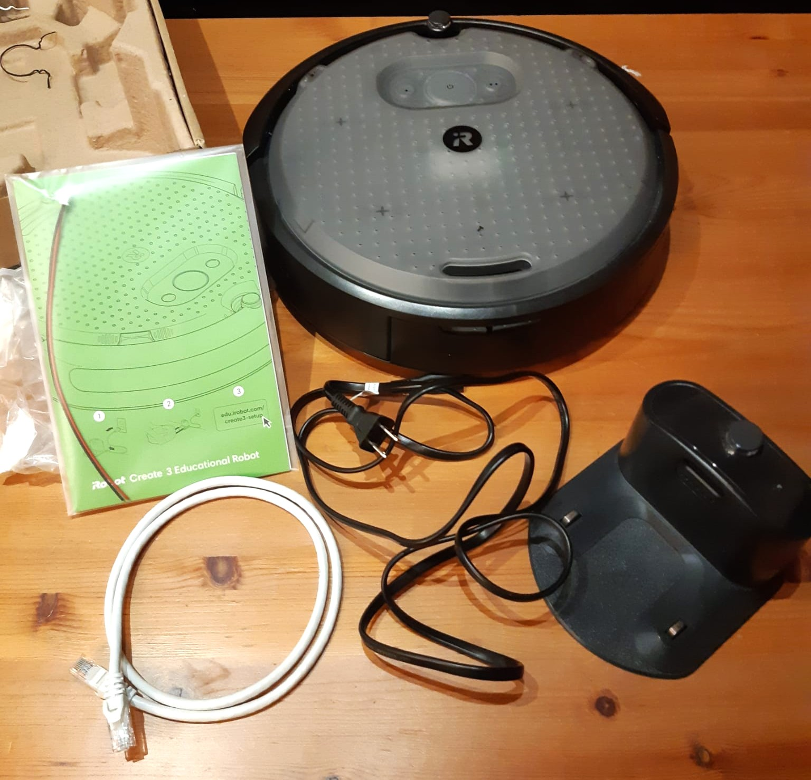
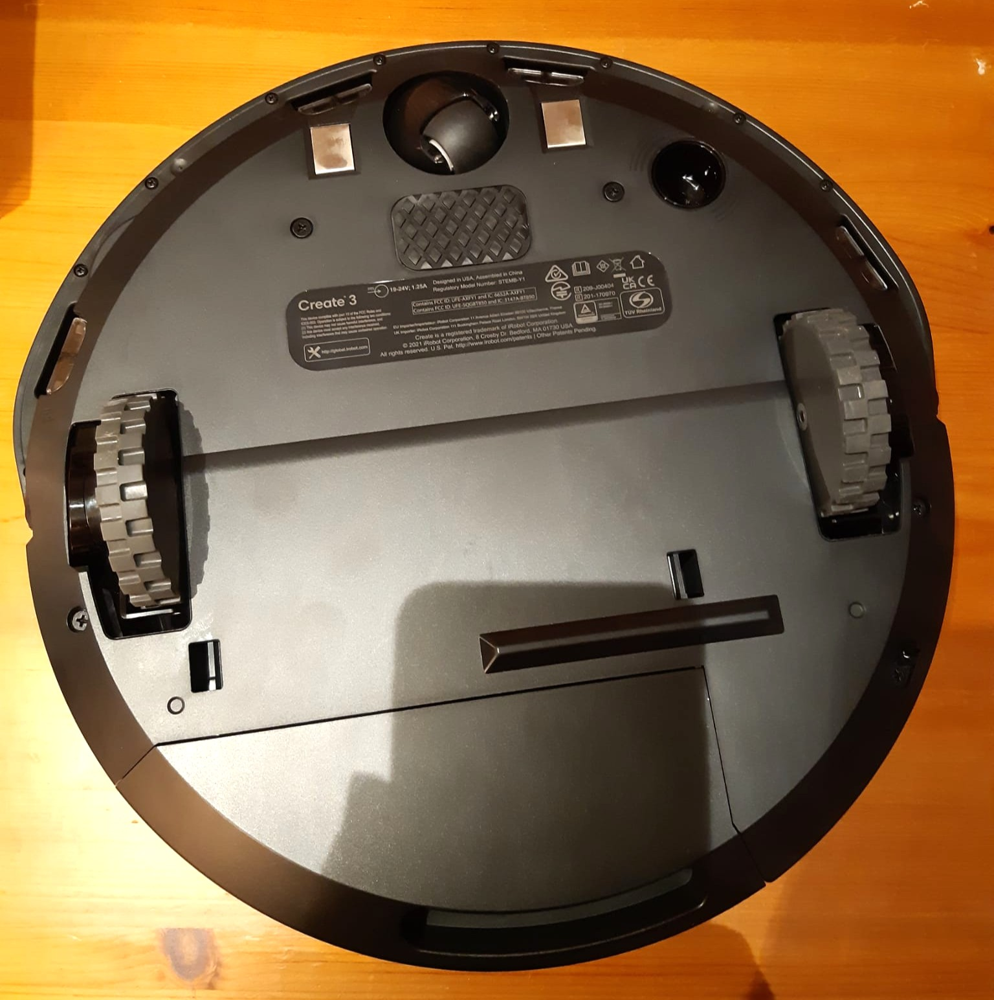
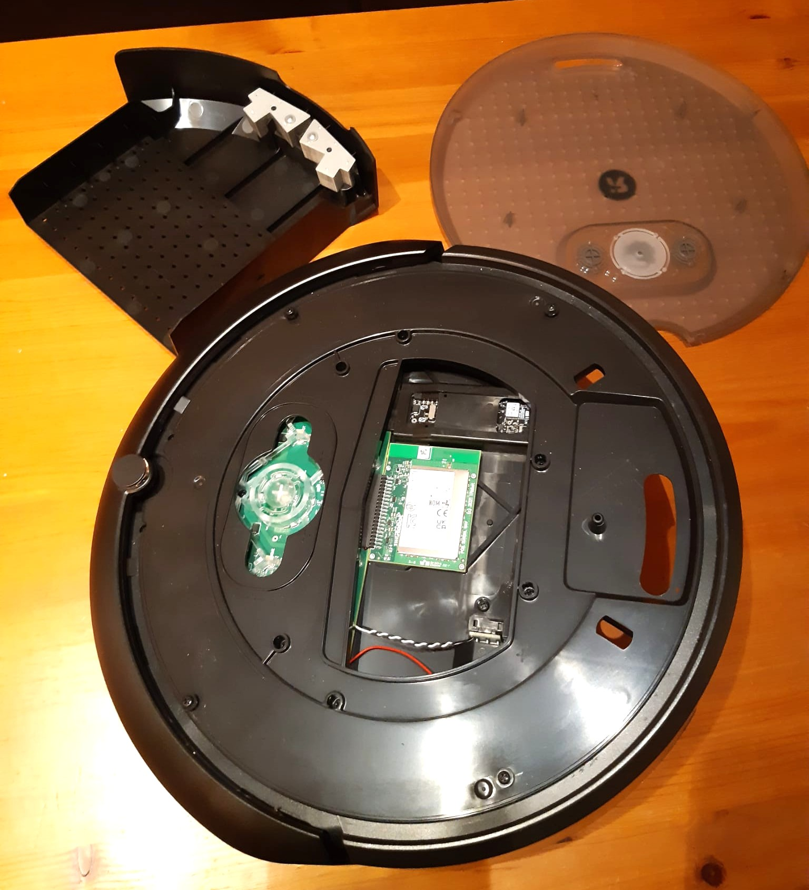

# iRobot Create 3

This repository documents my learning, experiments, assignments, and projects using the iRobot Create 3 Educational Robot.

## Goals

- Learn how to set up and configure the iRobot Create 3
- Practice ROS 2
- Explore the robot's sensors, movement, docking, and networking
- Build small robotics experiments
- Document assignments and larger projects
- Keep notes, troubleshooting steps, and useful references in one place

## Repository Structure

- `00-documentation/` - documentation, notes, and useful links
- `01-setup/` - setup, firmware, networking, and configuration notes
- `02-practice/` - small practice exercises
- `03-assignments/` - course assignments involving the Create 3
- `04-projects/` - larger robotics projects
- `05-experiments/` - independent experiments and testing
- `images/` - photos, screenshots, diagrams, and project images

## Current Status

- iRobot Create 3 acquired
- Local project workspace created
- Git repository initialized
- Hardware inventory and initial inspection completed
- Initial setup and exploration in progress

## Robot

**Platform:** iRobot Create 3 Educational Robot

**Regulatory model:** STEMB-Y1

The robot was purchased used and includes the Home Base charging dock, power cable, Ethernet cable, printed documentation, original packaging, and a raw battery power pigtail.

## Hardware Overview

### Underside

The underside contains the drive wheels, caster wheel, cliff sensors, optical odometry sensor, charging contacts, and other mechanical components.

### Cargo Bay

The removable top faceplate provides access to the cargo bay, which can be used for additional compute hardware and electronics.

Detailed hardware photos and notes are documented in `01-setup/hardware-inventory.md`.

## Documentation

Useful links and learning resources are stored in:

- `00-documentation/useful-links.md`
- `00-documentation/notes.md`

Hardware inspection and setup documentation are stored in:

- `01-setup/hardware-inventory.md`

## Next Steps

- Verify power and charging
- Check battery condition
- Access the Create 3 web interface
- Record the installed firmware version
- Review the current network configuration
- Begin ROS 2 communication and basic experiments